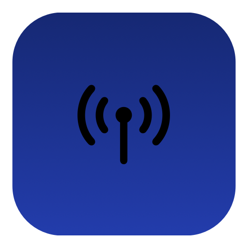

<p align="center">
  
</p>

<h1 align="center">Apfelbindung</h1>

<p align="center">
  <strong>Your Android phone and your Mac, natively connected.</strong><br>
  A KDE Connect client for macOS. Zero dependencies.
</p>

<p align="center">
  
  
  
  
  
</p>

---

## A fork of KonnectMac

Apfelbindung is a **fork** of [KonnectMac](https://github.com/aryarajsingh/KonnectMac),
the native KDE Connect client for macOS created by **Aryaraj Singh**. All credit for the
original design, the protocol work and the codebase belongs to him.

This fork exists because I wanted an app that fits my daily use better: a friendlier UI,
fewer disconnects and features the original project does not cover yet. It is not a
commercial product — it is a personal, open project released under the same GPL v3 license.

> **Migration note:** the fork uses a new bundle identifier (`com.apfelbindung.app`).
> If you were using KonnectMac, uninstall it first (`./uninstall.sh`) and pair your phone
> again on first launch.

## Why "Apfelbindung"?

**Apfel** (apple) + **Verbindung** (connection). The *-bindung* comes from *Verbindung*,
and the *fel* in *Apfel* echoes the *Ver-* sound, so the two words blend into one name that
reads as "apple connection". A small nod to KDE Connect's German roots and to the Apple
ecosystem.

## What is Apfelbindung?

Apfelbindung is a **native macOS menu bar app** that connects your Android phone to your Mac
over the [KDE Connect](https://kdeconnect.kde.org/) protocol. It works with the official KDE
Connect Android app (v1.34+) from
[Google Play](https://play.google.com/store/apps/details?id=org.kde.kdeconnect_tp) and
[F-Droid](https://f-droid.org/packages/org.kde.kdeconnect_tp/).

No Electron. No web views. No third-party dependencies. Pure Swift + AppKit + SwiftUI.

## Features

| Feature | Description |
|---------|-------------|
| **Notification center** | Mirror your phone notifications on the Mac with app icons, history, and OTP detection with one-click copy |
| **SMS viewer** | Full conversations and threads; read and reply from the Mac |
| **Call alerts** | Incoming and outgoing calls, with automatic media pause/resume |
| **Clipboard sync** | Bidirectional text clipboard sharing between Mac and phone |
| **File transfer** | Encrypted TLS transfers — drag files onto the menu bar icon |
| **Battery** | Phone battery level in the menu bar with low-battery alerts |
| **Find my phone** | Ring your phone from the Mac |
| **Ping** | Bidirectional connectivity check |
| **Direct connection** | Pair by IP when UDP broadcast is unavailable (Tailscale, VLANs, etc.) |

## Differences from upstream

| Area | KonnectMac (upstream) | Apfelbindung (this fork) |
|------|-----------------------|--------------------------|
| **UI** | Menu bar popover | **Improved UI**: main window with sidebar, notification center with history, dedicated messages view, per-device settings and plugin toggles |
| **Stability** | Early project base | Protocol v8, fresh TLS identity per connection, proper TLS close (`close_notify`), reconnect with backoff and a real connect timeout, KDE Connect-aligned TCP keepalive, sleep/wake recovery |
| **Messaging** | Notifications and OTP detection | **SMS viewer**: conversations, per-thread history, sending, local cache |
| **Discovery** | Periodic UDP announce | Churn-free broadcast: no announce while a paired session is active, standard UDP port 1716 |
| **Connectivity** | LAN only | LAN + direct IP connection (useful with Tailscale or networks without broadcast) |
| **Packaging** | Manual `.pkg` | Automatic `.pkg` via **GitHub Actions** on tag push |
| **Scope** | Core features | On the road to **1:1 KDE Connect parity** |

## KDE Connect parity

Apfelbindung currently covers **8 of the 25 feature areas** exposed by the KDE Connect
desktop client (3 of them partially), and the gap is documented plugin by plugin:

- ✅ Notification mirroring, SMS, calls, clipboard (text), file transfer, ping, battery,
  find my phone
- 🚧 Partial: notification actions, SMS/MMS attachments, clipboard files
- ⏳ Pending: remote input (trackpad/keyboard), presenter, media control, system volume,
  remote commands, lock device, contacts, connectivity report, SFTP, and more
- ❌ Not applicable on macOS: virtual monitor

See **[ROADMAP.md](ROADMAP.md)** for the full gap analysis, packet types, required macOS
APIs, permissions and effort estimates — plus the checklist to ship the app properly
(signing, notarization, universal binary, Homebrew cask, updates, tests).

## Download

📦 **[Latest release](https://github.com/rockmadehome/Apfelbindung/releases/latest)** (`.pkg` installer)

> **Note:** the app is neither signed nor notarized, so macOS may show an "unidentified
> developer" warning. Right-click the app → **Open** to bypass it.

## Setup

### Requirements

- macOS 14 (Sonoma) or later
- [KDE Connect](https://play.google.com/store/apps/details?id=org.kde.kdeconnect_tp) on your
  Android phone
- Both devices on the same Wi-Fi network (or connected through
  [Tailscale](https://tailscale.com/))

### Getting started

1. **Install** Apfelbindung and KDE Connect on your phone
2. **Launch** Apfelbindung — the onboarding wizard walks you through permissions
3. **Pair** — your phone appears automatically; click to pair and verify the security key
4. **Done** — look for the antenna icon in the menu bar

### OTP/SMS visibility (Android 15+)

Android 15 hides sensitive notification content from third-party apps. To enable OTP/SMS
visibility for KDE Connect:

```bash
brew install android-platform-tools
adb shell appops set org.kde.kdeconnect_tp RECEIVE_SENSITIVE_NOTIFICATIONS allow
```

The onboarding wizard covers this step too.

## How it works

```
Mac                              Phone
 │                                 │
 ├──── UDP broadcast ────────────► │  Discovery (port 1716)
 │ ◄──── TCP connect ─────────────┤  Phone connects to the Mac
 │                                 │
 ├──── TLS handshake ────────────► │  Encrypted channel (self-signed certs)
 │ ◄──── Identity exchange ───────┤  Both sides identify
 │                                 │
 ├──── Pair request ─────────────► │  SHA256 verification key (+ v8 timestamp)
 │ ◄──── Pair accept ─────────────┤  Certificate pinned
 │                                 │
 │ ◄═══ Encrypted JSON packets ══► │  Notifications, SMS, clipboard, files...
```

## Security

- **End-to-end TLS** on every channel (main connection, file transfers, icon downloads)
- **Certificate pinning** after pairing — impersonators are rejected
- **Fresh TLS identity per connection** — avoids failed handshakes after the Mac sleeps
- **SHA256 verification key** (with `timestamp`, protocol v8) shown during pairing
- **App-specific keychain** — no login keychain prompts
- **No sensitive data in logs** — OTP codes, notification text, contact names and clipboard
  contents are never logged

## Build from source

### Requirements

- macOS 14 (Sonoma) or later
- Xcode 15+ (with Command Line Tools)

### Build

**Option A — Xcode (recommended)**

1. Open `Apfelbindung.xcodeproj` in Xcode
2. Select the **Apfelbindung** scheme → **Release** configuration
3. Press **Cmd+B**

**Option B — Command line**

```bash
git clone https://github.com/rockmadehome/Apfelbindung.git
cd Apfelbindung
xcodebuild -project Apfelbindung.xcodeproj -scheme Apfelbindung -configuration Release build
```

### Run

**From Xcode:** press **Cmd+R**.

**From the command line:** after building, the app is in your DerivedData folder:

```bash
open "$(xcodebuild -project Apfelbindung.xcodeproj -scheme Apfelbindung -configuration Release -showBuildSettings 2>/dev/null | grep -m1 'BUILT_PRODUCTS_DIR' | awk '{print $3}')/Apfelbindung.app"
```

Or copy it to `/Applications` for regular use:

```bash
BUILT=$(xcodebuild -project Apfelbindung.xcodeproj -scheme Apfelbindung -configuration Release -showBuildSettings 2>/dev/null | grep -m1 'BUILT_PRODUCTS_DIR' | awk '{print $3}')
cp -R "$BUILT/Apfelbindung.app" /Applications/
open /Applications/Apfelbindung.app
```

> **Note:** macOS may warn about an unidentified developer on first launch. Right-click the
> app → **Open**.

### Create a `.pkg` installer

```bash
./build-pkg.sh
```

This builds the app in Release mode and generates `Apfelbindung-<version>.pkg` in the project
root. Double-click to install, or from the command line:

```bash
sudo installer -pkg Apfelbindung-3.0.pkg -target /
```

## Releases with GitHub Actions

The repository ships [`.github/workflows/release.yml`](.github/workflows/release.yml), which
builds and publishes an installer without a local Mac:

1. **Automatic:** pushing a `v*` tag (for example `v3.0`) builds the app on a macOS runner,
   generates the `.pkg`, and creates a GitHub Release with the package and its SHA256
   checksum attached.
2. **Manual:** from *Actions → Release → Run workflow* you can build and download the `.pkg`
   as an artifact without publishing anything.

```bash
git tag v3.0
git push origin v3.0
```

The version comes from the tag (`v3.0` → `3.0`) and is injected into the Xcode build, so the
package name and the version shown in the app stay in sync with the release. The `.pkg` is
unsigned: removing the Gatekeeper warning requires an Apple Developer certificate and
notarization.

<details>
<summary><strong>Architecture</strong></summary>

```
Apfelbindung/
├── ApfelbindungApp.swift         — Entry point, menu bar, onboarding
├── OnboardingView.swift          — First-launch setup wizard
├── PreferencesView.swift         — Settings: General, Devices, About
├── MenuBarView.swift             — Menu bar popover
├── MainView.swift                — Main window (notifications, messages, settings)
├── NotificationPanelView.swift   — Notification panel
├── Core/
│   ├── NetworkPacket.swift       — JSON packet serialization
│   ├── Config.swift              — UserDefaults, capabilities, identity
│   ├── Device.swift              — Device model
│   ├── DeviceManager.swift       — Discovery, connections, pairing
│   ├── CertificateManager.swift  — TLS certificate generation & keychain
│   ├── Logger.swift              — Thread-safe rotating file log
│   ├── NotificationStore.swift   — Notification history
│   └── SMSStore.swift            — SMS conversations, messages and cache
├── Network/
│   ├── UDPDiscovery.swift        — BSD socket UDP broadcast
│   ├── LanServer.swift           — BSD socket TCP server
│   ├── KDEConnection.swift       — Full TLS connection lifecycle
│   └── VerificationKeyHelper.swift — SHA256 pairing verification
├── Pairing/
│   └── PairingHandler.swift      — Pairing state machine
└── Plugins/
    ├── PluginProtocol.swift      — Plugin interface
    ├── PingPlugin.swift          — Bidirectional ping
    ├── BatteryPlugin.swift       — Battery level & alerts
    ├── NotificationPlugin.swift  — Notification mirroring & OTP detection
    ├── TelephonyPlugin.swift     — Call alerts & media control
    ├── SMSPlugin.swift           — SMS reading & sending
    ├── ClipboardPlugin.swift     — Clipboard sync
    ├── FindMyPhonePlugin.swift   — Ring the phone
    └── SharePlugin.swift         — File transfer
```

</details>

<details>
<summary><strong>Tech stack</strong></summary>

| Component | Choice | Why |
|-----------|--------|-----|
| Language | Swift 5.9+ | Native, fast, type-safe |
| UI | SwiftUI + AppKit | SwiftUI for views, AppKit for menu bar and windows |
| Networking | BSD sockets | Network.framework cannot do TLS startTLS |
| TLS | SecureTransport | Ships with macOS, no dependencies |
| Certificates | openssl CLI + Keychain | Self-signed RSA-2048, app-specific keychain |
| Media control | MediaRemote (private) | Only way to pause/resume without Accessibility |

</details>

## Branches

| Branch | Purpose |
|--------|---------|
| `stable` | Production releases |
| `beta` | Testing builds |
| `alpha` | Active development |

## Credits

- **[KonnectMac](https://github.com/aryarajsingh/KonnectMac)** — the original project by
  **Aryaraj Singh**, which this fork is based on.
- **[KDE Connect](https://kdeconnect.kde.org/)** — the protocol and the reference
  implementations (`kdeconnect-kde`, `kdeconnect-android`).

If the original project is useful to you, consider supporting its author:
[github.com/sponsors/aryarajsingh](https://github.com/sponsors/aryarajsingh).

## License

Apfelbindung is released under the [GNU General Public License v3.0](LICENSE), the same
license as the original project.

Copyright © 2026 Aryaraj Singh (original project).
Fork modifications © 2026 Apfelbindung contributors.

### What GPL v3 allows and requires

GPL v3 **allows** you to use, study, modify, rename and redistribute the software, even
commercially. It also **allows** publishing a fork under a different name. In return it
**requires** you to:

- keep the GPL v3 license in the fork and make the source available;
- preserve copyright notices and acknowledge the original authorship;
- state what was changed relative to the original;
- avoid using the original author's name or trademarks to endorse the fork (hence the
  rename to Apfelbindung).

This fork is **not commercialized**: it is published for free and without profit. That is a
personal choice, not a license obligation.

---

<p align="center">
  Built with care for the Mac.
</p>
